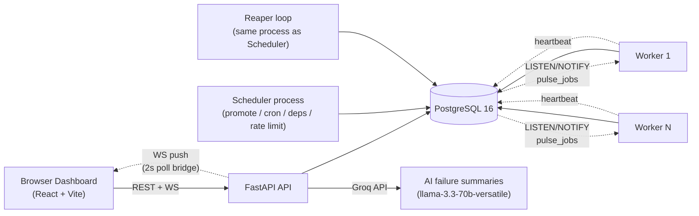
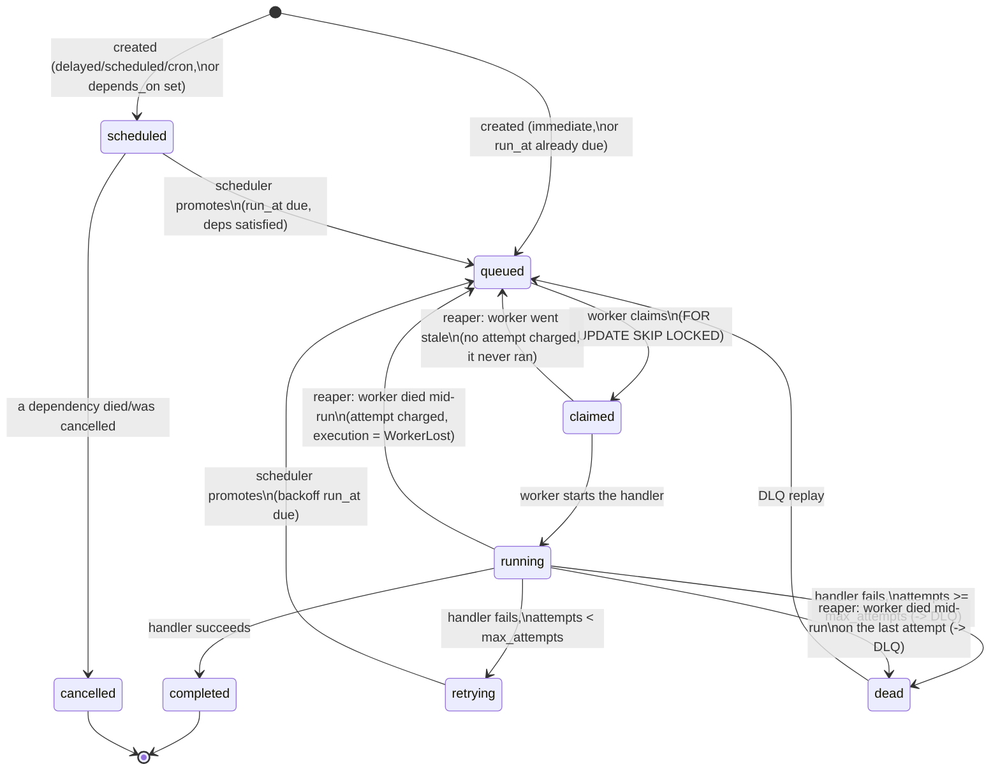
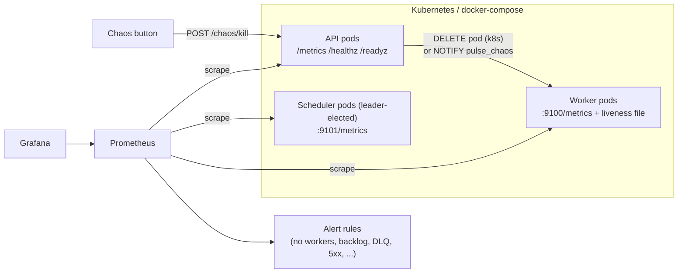

# Architecture

Pulse is five processes sharing one Postgres database: no Redis, no message
broker — `FOR UPDATE SKIP LOCKED` plus `LISTEN/NOTIFY` do the jobs a second
datastore would normally be reached for (see
[design-decisions.md](./design-decisions.md) for why).

## Processes and responsibilities

| Process | Container | Responsibilities |
|---|---|---|
| **API** | `api` | Auth (JWT), CRUD for orgs/projects/queues/jobs/retry-policies/workers, enqueue, retry/cancel, DLQ replay, metrics endpoints, WS fan-out. **Never executes a job handler.** |
| **Scheduler** | `scheduler` (safe to run several replicas: one leader per tick via a Postgres advisory lock) | Every `SCHED_TICK_SEC` (1s): promotes due `scheduled`/`retrying` jobs to `queued` (rate-limited per queue where configured), fires cron/recurring templates, resolves workflow dependencies. Runs the reaper as a second concurrent loop in the same process (every `REAPER_TICK_SEC`, default 5s). |
| **Worker** | `worker` (scalable: `docker compose up --scale worker=N`) | Polls its subscribed queues, atomically claims a batch bounded by remaining concurrency, runs handlers concurrently under a semaphore, sends heartbeats, completes/fails jobs, hands failures to the retry engine. LISTENs on `pulse_jobs` for instant wake-up instead of waiting out its poll interval. Graceful shutdown on SIGTERM. |
| **Migrate** | `migrate` (one-shot; a Job in Kubernetes) | `alembic upgrade head` before anything else starts, so scaling the API never races migrations. |
| **Seed** | `seed` (one-shot) | Idempotent: creates the demo org/user/project/retry-policy/queues + a mix of immediate/delayed/batch/cron/failing jobs on first boot, then exits. |
| **Frontend** | `frontend` | Vite build served by nginx in production (dev server + proxy locally); nginx also proxies `/api` (incl. WS upgrade) to the `api` container. |

## Data flow: one job's life

## Why this shape

- **API never runs job code.** Keeping execution entirely in worker
  processes means the API's request/response latency is never at the mercy
  of a job handler (an `http_call` hitting a slow endpoint, a `sleep`, ...).
- **Scheduler and reaper share a process** because they're both lightweight,
  low-frequency background loops with no per-request latency requirement —
  running them as two `asyncio` tasks in one container is simpler ops than
  two containers for work this small, without losing either loop's ability
  to fail/restart independently in principle (they're just two `asyncio.gather`
  coroutines; a crash in one is caught and logged per-tick, not fatal to the
  process).
- **Workers scale horizontally trivially** (`docker compose up --scale
  worker=N`) because all coordination — atomic claim, concurrency ceiling,
  crash recovery — lives in Postgres, not in worker-to-worker communication.
  Verified under real 3-worker contention in Phase 5 (see design-decisions.md
  §4, distributed locking).

## Operations: observability, self-healing, chaos

**Metrics.** Every process exports Prometheus metrics (`app/core/observability.py`).
Process-local counters (HTTP traffic labelled by *route template*, never raw
paths, which carry UUIDs; executions and durations per handler; scheduler
promotions; reaper recoveries) live in the process that does the work.
Fleet-wide state (jobs by status, workers by status, DLQ backlog) is read from
Postgres by the API at scrape time and cached for 5s, so it is reported exactly
once no matter how many workers run. `deploy/prometheus/alerts.yml` and the
provisioned Grafana dashboard in `deploy/grafana/` are built on these.

**Self-healing**, layer by layer:

| Failure | Detected by | Recovery |
|---|---|---|
| Worker process crashes or is killed | its supervisor (Deployment, `restart: always`, supervisord) | a replacement starts immediately |
| Worker event loop wedges (alive but stuck) | liveness probe: `python -m app.worker.healthcheck` checks the heartbeat file's age | kubelet / docker restarts the container |
| Jobs stranded on a dead worker | reaper: no heartbeat for `VISIBILITY_TIMEOUT_SEC` | requeued; an attempt is charged if the handler had started, so a job that keeps crashing workers ends up in the DLQ instead of looping forever |
| Worker wrongly declared dead (GC pause, DB blip) | the worker itself, on its next heartbeat | it revives its status, so the reaper stops sweeping its new claims |
| Scheduler leader dies | its advisory lock is released with its DB connection | a standby replica leads from the next tick |
| API pod loses the database | readiness probe `/readyz` | pulled from the Service until the DB is back (liveness does not check the DB, so there is no restart storm) |

**Chaos engineering.** `POST /chaos/kill` (admin only; a button on the Dashboard
and Workers pages, or `python cli.py cluster kill`) hard-kills a live worker:
it deletes the worker's pod with `gracePeriodSeconds=0` when running in-cluster
(the `pulse-chaos` Role in `k8s/base/rbac.yaml` allows exactly that), otherwise
it NOTIFYs the worker on `pulse_chaos`, which makes it `os._exit(137)` without
draining. Each recovery row above is then visible live: the restart on the
Workers page, the requeued jobs (with a `WorkerLost` execution) in Job detail,
and the counters in Grafana.
